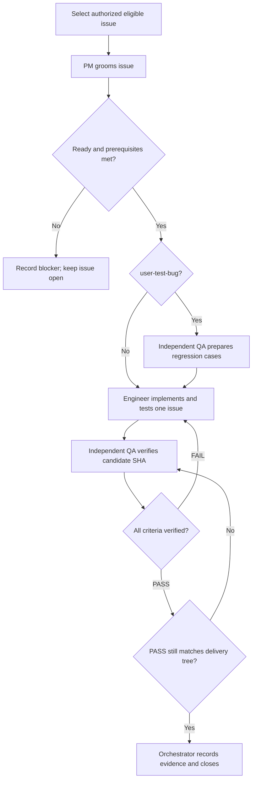

# FreshFirst development process

## Adoption and source

Introduced on 2026-10-20 for future authorized work. This setup does not start an issue or a backlog loop. Earlier implementation, test runs and 33 retrospective closures did not use this documented PM/Engineer/QA workflow; do not invent historical handoffs or QA PASS comments. Keep those records intact. A newly reopened issue or new bug follows this process.

The role separation and feedback loop adapt Alexey Grigorev's first course article, [AI-Native Development: Specifications, Loop and Graph Engineering](https://aishippingblog.com/p/ai-native-development-specifications). FreshFirst's evidence format, budget rules, worktree discipline and user-bug intake below are repository-specific operational rules. Markdown instructions describe orchestration; they do not install an autonomous runner, CI service or automatic GitHub enforcement.

## Sources of truth

- [Product specification](spec.md): operative MVP boundary, integrity constraints and scope-decision history.
- [GitHub Issues](https://github.com/ttogzhann/freshfirst-market/issues?q=is%3Aissue): active tasks, dependencies, current acceptance criteria and handoff evidence.
- [Approved issue plan](issues-plan.md): original FF identifiers, execution order, estimates and historical evidence; a planning baseline rather than a second live status tracker.
- [OpenAPI contract](../openapi.yaml): all 23 operation IDs, request/response schemas and errors.
- [Task template](task-template.md), [testing guidelines](testing-guidelines.md) and role contracts: how to perform the work.

If an issue conflicts with the specification or contract, PM records the conflict and resolves it before implementation; the engineer cannot silently lower acceptance criteria. Material product scope changes require the user's decision and a specification change log. Routine implementation choices within the groomed issue need no extra permission. Check actual issue state rather than cached milestone counters.

Inspection at setup found 48 issues: 33 retrospective closed issues, 13 remaining MVP issues and two open Post-MVP enhancements (#20 and #43). This is a dated observation, not a permanent status assertion. No issue states or acceptance criteria are changed by installing this process.

## Responsibilities and permissions

| Role                                           | Owns                                                                                                                                         | Must not do                                                                     |
| ---------------------------------------------- | -------------------------------------------------------------------------------------------------------------------------------------------- | ------------------------------------------------------------------------------- |
| Orchestrator (main session)                    | Select eligible work, dispatch separate role contexts, preserve handoffs, track time, coordinate integration and close after a valid QA PASS | Groom, implement or judge its own issue; skip a role; start an unrequested loop |
| [PM](team/pm.md)                               | One issue's scope, observable acceptance criteria, dependencies and readiness                                                                | Implement a fix, waive integrity criteria or close the issue                    |
| [Software Engineer](team/software-engineer.md) | One groomed issue's minimal implementation, meaningful tests, commit and handoff                                                             | Change agreed criteria to fit the code, self-approve QA or close the issue      |
| [QA Engineer](team/qa-engineer.md)             | Independent cases, criterion-by-criterion verification and PASS/FAIL evidence                                                                | Repair application/tests/configuration to make a check pass or close the issue  |

Use a separate agent context or fresh session for each role; the implementing agent cannot also be its QA reviewer. Give QA the issue, repository/commit and engineer handoff, not a request to rubber-stamp the engineer's conclusion. When independent QA cannot run, record a blocked verification and leave the issue open; do not simulate a second reviewer through role-playing.

Only perform GitHub edits/comments that the user's authorized issue work covers. This setup authorizes creating the `user-test-bug` label, not grooming all 48 issues, changing their states or creating new tasks. Pushing code, merging, deployment and external messages need their own applicable authorization; local implementation authority does not imply all of these.

## Single-issue loop

1. **Select:** on an explicit issue request, handle that issue; on an explicitly requested MVP loop, select an open ready MVP issue by priority and dependencies. Do not reopen historical tasks to inflate work. #18 is the first source-feasibility gate in the current plan, not an instruction to execute it now. Post-MVP #20/#43 are excluded from an MVP loop.
2. **Groom:** PM rewrites the selected issue using all four template sections, preserving original context/evidence and FF identity. Assign criterion IDs such as AC-01, dependencies, priority, files, timebox and verification approach. Record a revision marker or dated readiness comment so handoffs refer to the same criteria. A closed prerequisite is not sufficient if the required capability demonstrably regressed.
3. **Prepare user-bug cases:** for `user-test-bug`, QA writes mapped reproduction/regression cases before engineering starts. This is test planning, not a PASS on unfixed behavior. For other tasks, independent cases may be prepared before or during implementation.
4. **Implement:** engineer works on just this groomed issue, runs appropriate checks and commits the candidate. The handoff includes exact SHA, changed files, test commands/results, known limitations and actual effort. The issue remains open. Avoid automatic closure keywords such as `Fixes #N` in a commit/PR before QA; use `Refs #N`.
5. **Verify:** fresh QA reads the criteria, inspects the candidate and independently executes the required checks. It publishes the [QA report](team/qa-engineer.md#verdict-format) with a result for every criterion, exact tested SHA and evidence.
6. **Repair:** on **QA FAIL**, orchestrator returns the same issue and linked failure report to the engineer. Reproduction failure, unavailable tooling or unverified criteria cannot become PASS. Specification conflicts go to PM rather than being patched around. Rework consumes the same time budget. Re-run QA after the new commit; never reuse a verdict for changed behavior.
7. **Close:** only orchestrator may close after the latest independent **QA PASS** covers every criterion on the delivered code. Verify the candidate matches the actual integration tree and that no later commit, changed criterion or unresolved QA FAIL invalidates it. If integration changes relevant code, return it to QA. Record tested/delivered SHA, QA comment link, acceptance revision and time; only then close as completed. A green engineer test suite alone is insufficient.
8. **Continue or stop:** continue only within an explicitly authorized loop and its issue set/time budget. Stop after the requested issue passes, the authorized subset is done, the budget expires or progress needs an external decision. For a blocked issue, record the blocker and select another eligible task only when the user authorized a loop. Never treat Post-MVP work as implicit overflow.

Workflow states (record in issue comments) are `Needs grooming -> Ready -> Engineering -> QA -> Closed`. `QA FAIL -> Engineering`; unresolved ambiguity returns to PM; `Blocked` stays open. GitHub's open/closed state alone is not a QA verdict. No additional workflow labels are required.

## User-discovered bugs

Use the `user-test-bug` label in addition to the existing milestone, area, priority and `bug` labels as appropriate. Preserve it through the whole lifecycle. PM searches open and closed issues first: add the report to a matching open issue, or create a clearly linked regression issue when the behavior is new; do not duplicate an existing fix task or rewrite a historical closure. Do not claim every existing issue is a user-discovered bug.

Required order: **user report -> PM grooming -> QA test cases -> engineer regression test/fix -> independent QA verification -> orchestrator closure after PASS**. Capture exact steps, expected/actual behavior, version/SHA, input data and failure impact without collecting secrets or a user's real pantry database. QA cases must reproduce the reported failure and relevant boundary/retry/restart behavior. Engineer adds the durable regression test; QA independently reruns the case and checks nearby workflows. A non-reproducible or environment-blocked report stays open with explicit missing evidence rather than a fabricated PASS.

A core integrity defect stays MVP even if discovered during a Post-MVP task. A user confirmation or a screenshot alone does not replace independent verification. Link any broader enhancement separately without dropping the reported defect.

## Worktrees, integration and time

Default to one issue at a time. When parallel execution is explicitly authorized, use the [plan's ownership boundaries](issues-plan.md#safe-parallel-agents-in-separate-git-worktrees) and separate Git worktrees/branches. Each engineer still owns one issue; each receives its own PM and independent QA handoffs. Avoid concurrent ownership of detail/hooks/startup files. Keep worktree-local databases, environments, generated builds and unique ports. QA needs the exact candidate or combined integration revision, not a stale branch.

All roles, planning, source inspection, test preparation, implementation, QA, rework and integration share the strict 12-hour aggregate cap; it is not per agent. Track actual minutes and remaining budget in handoffs. Preserve the existing nine-hour task allocation and three-hour reserve; debit workflow overhead too. Do not reset earlier spent time. Source feasibility keeps its 30-minute stop/go gate. Exhaustion means report incomplete/blocked MVP, never skip QA or guess source quantities.

## Starting a future run

A future request can say: "Process GitHub issue #N using docs/process.md; dispatch PM, engineer and independent QA, and stop after that issue's accepted closure or a blocker." The main session then dispatches the role documents and carries their output forward. A broader request must name MVP or another explicit issue set and budget; it must not silently include Post-MVP work.

If the runtime cannot dispatch independent agents, use separate human-driven sessions with the same artifacts and role separation. Do not add an automated runner, goal, hook or CI pipeline merely to install these instructions. This documentation task runs only documentation/configuration checks and commits its files; it does not groom or implement the remaining issues.
